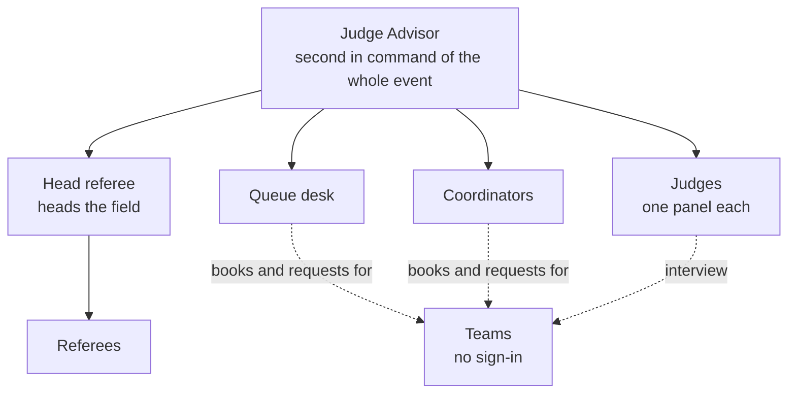
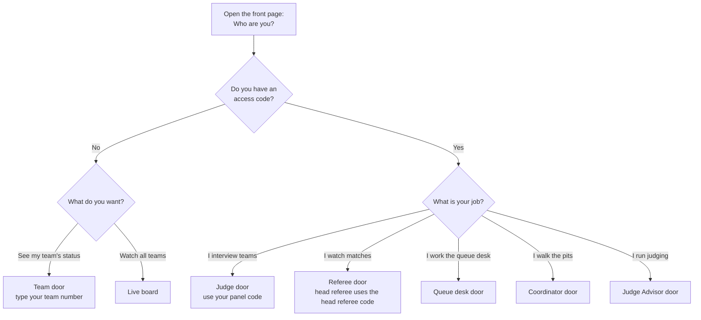
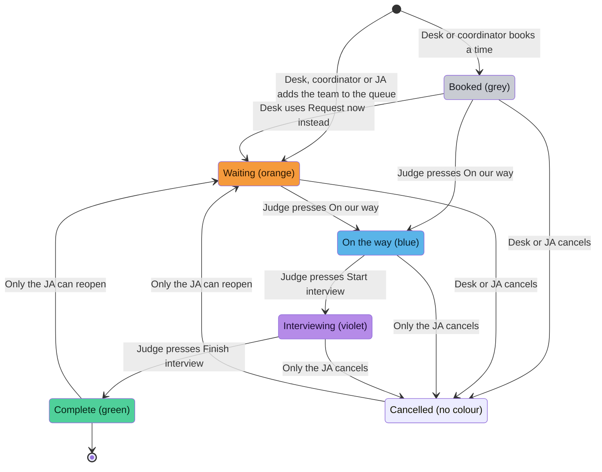

# Judge Queue: start here

Judge Queue runs the judging side of a VEX robotics event (VEX IQ and V5RC).
Teams ask the queue desk for an interview. Judges work through a queue and score each team.
Referees record what they see on the field. The Judge Advisor (JA) runs it all and decides the awards.
A colour-coded Live board shows every team's judging status on a TV and on phones.

This guide is for the people who use the app at the event. The JA uses it to train everyone else.

## The roles and their doors

Open the app's front page. It says **Who are you?** and shows one door for each role. Pick yours.

| Role | Door on the front page | What you do | Your page |
|---|---|---|---|
| **Judge Advisor (JA)** | Judge Advisor | Runs the whole event. Second in command. Can step in anywhere. | [judge-advisor.md](judge-advisor.md) |
| **Head referee** | Referee | Heads the field. A referee who also sets the program and fields, and fixes or removes flags. | [referee.md](referee.md) |
| **Referee** | Referee | Records flags about what happened on the field. | [referee.md](referee.md) |
| **Judge** | Judge | Interviews teams on one panel. Writes notes and scores. | [judge.md](judge.md) |
| **Queue desk** | Queue desk | Puts teams in the queue and books times. | [queue-desk.md](queue-desk.md) |
| **Coordinator** | Coordinator | Walks the pits. Sets team languages. Adds teams to the queue and books times. | [coordinator.md](coordinator.md) |
| **Team** | Team | Checks its own judging status. No sign-in. | [teams-and-live-board.md](teams-and-live-board.md) |
| **Anyone** | Live board | Watches every team's status. No sign-in. | [teams-and-live-board.md](teams-and-live-board.md) |

## Chain of command

The JA is second in command of the whole event. The head referee heads the field.
In the app, the JA can do everything the other roles can do, with one exception: only a referee can file a flag.

## Which door do I use?

## A team's interview journey

A team moves through these steps. The colours are the same on the Live board, the queue desk and the team page.

| Step | What the app says | Colour | What it means |
|---|---|---|---|
| Booked | Booked | Grey | The team has a time slot later. Nobody needs to act yet. |
| Waiting | Requesting (a judge) | Orange | The team is standing there and needs a judge. This is the one to watch. |
| On the way | On the way | Blue | A judge has said they are coming. |
| Interviewing | Interviewing | Violet | The interview is happening now. |
| Complete | Complete | Green | The interview is finished. |

A request can also be **Cancelled**. It then has no colour on the board.

## Who can do what

✅ means yes. — means no. A note in the box says where the limit is.
Teams never sign in, so the Team column shows what a team can do on its own pages.

| Action | JA | Head ref | Referee | Judge | Queue desk | Coordinator | Team |
|---|---|---|---|---|---|---|---|
| **Look** | | | | | | | |
| See the Live board and a team's status page | ✅ | ✅ | ✅ | ✅ | ✅ | ✅ | ✅ no sign-in |
| Read the note the desk wrote for the judges | ✅ | — | — | ✅ | ✅ | — | — |
| **Queue and bookings** | | | | | | | |
| Add a team to the queue (walk-up) | ✅ | — | — | — | ✅ | ✅ only if the team has no request yet | — ask the desk |
| Book a time slot for a team | ✅ | — | — | — | ✅ | ✅ only if the team has no request yet | — ask the desk |
| Write a note for the judges when requesting | ✅ | — | — | — | ✅ | — | — |
| Undo or cancel a request that judges have not answered yet | ✅ | — | — | — | ✅ | — | — |
| Reschedule a booking, or move it into the queue now | ✅ | — | — | — | ✅ | — | — |
| Move a request to a different panel | ✅ | — | — | — | — | — | — |
| **The interview** | | | | | | | |
| Press On our way, Start interview, Finish interview | ✅ any panel | — | — | ✅ own panel only | — | — | — |
| Cancel an interview that judges already answered | ✅ | — | — | — | — | — | — |
| Reopen a request, reset its status, or fix its times | ✅ | — | — | — | — | — | — |
| Act on a team that has no panel | ✅ | — | — | — | — | — | — |
| **Judging record** | | | | | | | |
| Write private notes on a team | ✅ any team | — | — | ✅ own panel only | — | — | — |
| Score the Notebook and Interview sheets | ✅ any team | — | — | ✅ own panel only | — | — | — |
| See the score ranking | ✅ all teams | — | — | ✅ own panel only | — | — | — |
| Nominate a team for an award | ✅ any team | — | — | ✅ own panel, finished interviews | — | — | — |
| Decide the award winners | ✅ | — | — | — | — | — | — |
| **Referee flags** | | | | | | | |
| File a flag | — the JA cannot | ✅ | ✅ | — | — | — | — |
| Read flags | ✅ all | ✅ all | ✅ all | ✅ own panel's teams only | — | — | — |
| Correct a flag | ✅ | ✅ | — | — | — | — | — |
| Remove a flag | ✅ | ✅ | — | — | — | — | — |
| Set the program and number of fields for the day | ✅ | ✅ | — they only read it | — | — | — | — |
| **Setup** | | | | | | | |
| Set a team's interview language | ✅ | — | — | — | — they only see it | ✅ | — |
| Import, edit or remove teams, and give teams a panel | ✅ | — | — | — | — | — | — |
| Create panels, set slot times, read panel codes, manage the judge list | ✅ | — | — | — | — | — | — |
| Record or withdraw a conflict of interest | ✅ | — | — | — tell the JA | — | — | — |
| Read the Activity log | ✅ | — | — | — | — | — | — |
| Reset the day, or wipe the whole event | ✅ | — | — | — | — | — | — |

Three rules sit behind this table:

- **Own panel only.** A judge can only work with teams on the panel whose code they typed. Teams on other panels do not even appear.
- **A team needs a panel first.** The desk, a coordinator or the JA can only queue or book a team that already has a panel.
- **Not everything is visible to everyone.** Judging notes, scores, conflicts and referee flags are private to the people marked above. Teams and the queue desk never see flags.

## How sign-in works

Every role except Team signs in with an **access code**. You type the code, and sometimes your name.
The code decides who you are. You do not pick a role.

| Role | Door | What you type | Your name |
|---|---|---|---|
| Judge Advisor | Judge Advisor | Your own JA code. Up to four JAs each get a separate code. | Optional. Shown in the Activity log. |
| Judge | Judge | Your panel's code. Everyone on the same panel shares it. | Optional |
| Queue desk | Queue desk | The queue desk code | Optional |
| Referee | Referee | The referee code | **Required.** Every flag you file carries your name. |
| Head referee | Referee | The head referee code. It is different from the referee code. | **Required** |
| Coordinator | Coordinator | The coordinator code | **Required.** Every booking you make carries your name. |
| Team | Team | Your team number. No code. | Not needed |

The JA gives you your code. Do not post codes on a public screen or in a group chat that teams can read.
Panel codes are different for each panel. The JA reads them in the Panels section.

Good to know:

- Letters can be upper or lower case. The app makes them capitals.
- If you open the wrong door, a correct code still takes you to your own screen.
- After many wrong codes, the app says **Too many attempts**. Wait a few minutes and try again.
- A judge is signed out at the end of the day. A judge is also signed out if the JA deletes the panel.
- If your code does not work, ask the JA. Do not keep guessing.

## Role pages

| Page | For |
|---|---|
| [judge-advisor.md](judge-advisor.md) | The Judge Advisor. Setup checklist, every section, the event-day routine, and how to train each role. |
| [judge.md](judge.md) | Judges |
| [referee.md](referee.md) | Referees and the head referee |
| [queue-desk.md](queue-desk.md) | The queue desk |
| [coordinator.md](coordinator.md) | Coordinators |
| [teams-and-live-board.md](teams-and-live-board.md) | Teams, and anyone watching the Live board |
