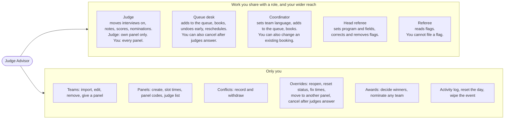

# Judge Advisor guide

You are the Judge Advisor (JA). You are second in command of the whole event.
You can step in anywhere: on any panel, at the queue desk, with a coordinator's work, and with the referees' setup.
This page is the detailed one. Start with the [overview](README.md) if you have not read it.

You sign in at the **Judge Advisor** door. Up to four people can be JAs, and each has their own code.

## What you control, compared with each role

## Your sections

The Judge Advisor screen has a side menu (a menu button on a phone). It has three groups.

| Group | Section | What it is for |
|---|---|---|
| Live | Floor | See every panel and every team in the queue right now |
| Live | Referee | See, correct and remove the flags referees filed |
| Setup | Teams | The team list, who judges whom, and the override tools |
| Setup | Panels | Judge panels, panel codes, slot times and the judge list |
| Setup | Conflicts | Record which judges are connected to which teams |
| Setup | Import | Load the team list from a file or by paste |
| Results | Scores | Rank the teams on points |
| Results | Awards | See nominations and decide winners |
| Results | Activity | The log of who did what |

The menu also has **Other consoles**: Queue desk, Judge, Referee and Big-screen board. Each opens in a new tab.
Numbers next to some sections help you decide where to look. Floor shows how many teams are waiting.
Conflicts shows the number of judge conflicts. Referee shows the number of flags. Teams and Panels show their totals. Awards shows how many awards are decided.

### Floor

**What it is for.** The live view. Each panel is a column of the teams in its queue.

**What you can do.**

- Read the counts at the top: Requesting, On the way, Interviewing, Complete.
- Read each card: team number and name, status, how long they have waited, interview language, referee flags.
- Press the big button on a card to move that team one step: On our way, Start interview, Finish.
- Open the **⋯** menu on a card:
  - **Move to panel…** sends the request to another panel. It only lists panels that judge the team's division and have no conflict with the team.
  - **Notes** opens the team sheet: notes, scores and flags.
  - **Cancel request** cancels the request or booking. It asks first.
- See amber warnings: a panel with a conflict with the team, or a panel that does not cover the language the team asked for. The app warns but does not block. You decide.
- Open the big-screen board with **Open big-screen board**.
- A column called **No panel** collects requests whose panel was deleted, so a waiting team never disappears.

**When to use it.** All day. Keep it open on the JA's laptop. Look for orange.

### Referee

**What it is for.** The record of what referees flagged, team by team.

**What you can do.** See the flagged teams and each team's history, newest first. Open a flag to **correct** it (wrong severity, wrong match number) or **remove** it. Both are logged in Activity. Removing asks first. Repeated rule warnings show here too.

**What you cannot do.** You cannot file a flag. Only a referee can. A flag must stay a record of what an official saw.

**To set the program and number of fields for the day:** open **Other consoles → Referee**. You see the same setup screen as the head referee. See "Referee setup" below.

**When to use it.** When a referee or the head referee asks for a correction, and before deliberation.

### Teams

**What it is for.** The team list and the tools to fix a team.

**What you can do.**

- Filter by number or name, division, notebook type or interview language. Counts show how many teams each panel holds and how many are unassigned.
- **Auto-assign**: deal unassigned teams across panels. Set **Max per panel** first. It keeps each team inside its own division, skips panels with a conflict, and matches language where it can.
- Open a team to edit its number, name, pit, division, notebook type, interview language and panel. Press **Save changes**.
- Under **Interview**, override the status with **Reset to…**. Under it you can also **Request** an interview now (one button per language), **Book a time**, or **Cancel booking** for a team.
- Under **Times**, fix the time of each step the request has reached, then **Save times**. Times are in Bangkok time. The status does not change.
- See the team's flags, and open the full team sheet.
- **Remove team** deletes the team and all its requests. It asks first.
- **Event data** at the bottom shows whether the app is saving to its database. It also holds the **Danger zone**: **Reset the day** and **Wipe everything**. Both ask first.

**When to use it.** During setup, and whenever a status is stuck or a team is on the wrong panel.

### Panels

**What it is for.** The judge groups, and the roster of judge names.

**What you can do.**

- **Add a panel** with a name and a division. The app gives it a judge sign-in code. You read it on the panel card, and **Copy** puts it on your clipboard.
- On each panel card, set the division, tick which languages the panel can **interview in**, and **Edit** the booking slots (first slot, minutes each, how many; set how many to 0 for walk-up only).
- **New judge** adds a name to the judge list. Then choose each judge's panel from the list. A judge sits on one panel at most. A panel's judge names come from this list.
- Moving a judge checks their conflicts first. If teams would come off the panel, the app asks you.
- **Delete panel** and **Delete all panels** remove panels. Teams stay but lose their panel. Every judge code stops working at once.

**When to use it.** During setup, and when a judge arrives, leaves or changes panel.

### Conflicts

**What it is for.** A judge connected to a team must not interview it, read its notes or see it at all. You collect these before panels are final.

**What you can do.**

- Pick a judge (or **+ New judge…**), type the team numbers, add an optional note, and record. Numbers can be separated by commas, spaces or new lines.
- Read the result: which numbers were recorded, which were already there, which are not real teams, and which teams the conflict took off the panel.
- **Withdraw** a conflict. This does not put the team back on the panel. You reassign it yourself.
- See a red warning when a team has no panel left that can take it.

**What happens when you record one.** The team comes off that judge's panel. It disappears from that panel's screens. Auto-assign will not put it back, and you cannot move it back by hand.

**When to use it.** Before you auto-assign. Ask each judge: "Which teams are you connected to?" Record the answers. Use it again any time a new connection comes up.

### Import

**What it is for.** Load the team list.

**What you can do.** Choose a file (`.xlsx`, `.csv`, `.tsv`), drop one on the box, or paste text. Check it in the box, then press **Import**.

- One team per line: number, name, pit, division. A header row is skipped.
- An optional fifth column sets the notebook type. An optional sixth column sets the interview languages (EN, TH, or both).
- A blank division means the first division in the list. Pits read best as a letter and a number, like A1. That places the team on the Live board's pit floor.
- Importing again updates teams. It never makes duplicates.
- Tick **Spread across panels evenly** and set **max per panel** to assign teams as you import. You need at least one panel first.
- The result shows how many teams were created, updated and skipped, and lists lines that could not be read.

The file is read in your browser. It is not uploaded anywhere. Old `.xls` files do not work. Save them as `.xlsx` or CSV.

**When to use it.** Once, after panels exist. Again if the list changes.

### Scores

**What it is for.** Every team ranked on points, from the judges' Notebook and Interview scores.

**What you can do.** Filter the list. Open a team to see its notes, scores and flags. Tick two teams to compare them side by side (total, notes, conduct). A team with no marks is shown as not scored, not as zero. The ranking never changes when you filter.

**When to use it.** During the day to see how many teams are scored, and at deliberation.

### Awards

**What it is for.** Judges nominate teams. You decide the winners.

**What you can do.**

- Pick a division. View a matrix (teams by awards) or a list per award.
- Open a nominee to see the scores, the reason each panel gave, and (for Sportsmanship) referees' Good conduct flags.
- **Give the award**, replace the winner, or clear it. Replacing and clearing ask first. You can change it until the ceremony.
- **Add team** or **Also nominate for…** puts any team in your own nomination.
- **Remove** a nomination, including a judge's.

Judges never see winners. Winners stay private until you announce them.

**When to use it.** After interviews, and at deliberation.

### Activity

**What it is for.** Who did what, newest first, grouped by hour.

**What you can do.** Filter by kind (Requests, Referee, Conflicts, Setup, Awards), by team number, or by person. It updates every few seconds. Open a team chip to see that team's sheet.

**When to use it.** When the floor gets confusing: "Who cancelled that?"

## Before the event: checklist

Do these in order. Tick each one.

**1. Codes and storage (usually done in the hosting dashboard, for example Vercel)**

- [ ] `SESSION_SECRET` is set to a long random string.
- [ ] `ADMIN_CODE` is set. Add `ADMIN_CODE_2`, `ADMIN_CODE_3` and `ADMIN_CODE_4` if you have more JAs. Give each JA a different code.
- [ ] `QUEUER_CODE` is set (queue desk).
- [ ] `COORDINATOR_CODE` is set. If it is empty, coordinators cannot sign in.
- [ ] `REFEREE_CODE` is set.
- [ ] `HEAD_REFEREE_CODE` is set, and it is different from `REFEREE_CODE`. If they are the same, the code is a plain referee code.
- [ ] `DATABASE_URL` is set to the database, so data is kept between requests.
- [ ] Do not use any example code printed in this project's documents. The live app refuses them, and that role cannot sign in.
- [ ] After you change a variable, redeploy. A change only works after a new deployment.
- [ ] Sign in and open **Teams → Event data** (at the bottom). It should say **Saved to the database**. A line that says **Saved to a local file** means the database is not connected, and data can vanish on a hosting service. A red warning means the app cannot reach its storage.

**2. Clear the old event**

- [ ] If this app held another event or demo data, open **Teams → Event data → Danger zone → Wipe everything**. This removes teams, panels, requests, notes, scores, conflicts and referee flags. Do it before you import the new event.

**3. Panels**

- [ ] **Panels → Add a panel** for each judge group. Set the division.
- [ ] Tick the languages each panel can interview in.
- [ ] **Edit** the booking slots for each panel, or set how many to 0 for walk-up only.
- [ ] Copy each panel's code and give it to that panel (see "How to onboard each role").

**4. Judges**

- [ ] **Panels → New judge** for each judge. Put each judge on a panel.

**5. Conflicts**

- [ ] Ask each judge which teams they are connected to. Record the answers in **Conflicts**. Do this before you auto-assign.

**6. Teams**

- [ ] **Import** the team list. Include the pit, division and, if you have them, notebook type and languages.
- [ ] Use **Spread across panels evenly**, or press **Auto-assign** in Teams.
- [ ] Check Teams for any **Unassigned** teams. Fix them by hand.
- [ ] Check the **Notebook** counts. Set a team's notebook type if the default is wrong.

**7. Interview languages**

- [ ] Check the **Language** strip in Teams. Teams with **Not asked** need a language. Coordinators ask teams in the pits and set it, or you set it yourself.
- [ ] Check that every panel covers the languages its teams need. Move a team if a panel does not.

**8. Referees**

- [ ] Tell the head referee to open the Referee screen first on each event day and set the program and number of fields. Plain referees cannot start until this is done. You can do it instead.

**9. Awards**

- [ ] Open **Awards**. The award list comes from the event setup file. If it says no awards are set up, ask whoever deployed the app.
- [ ] Tell judges they can nominate teams right after each interview.

**10. Test and hand out**

- [ ] Sign in once as each role to check each code works.
- [ ] Put the Live board on the judges' room TV and press **Fullscreen**.
- [ ] Give everyone their door and code (see below).
- [ ] If you ran a practice, press **Reset the day** to clear requests, notes, scores, nominations, winners and the Activity log. Teams, panels, judges, conflicts and referee flags stay. To clear referee flags too, use **Wipe everything** and import again.

## During the event: routine

1. Keep **Floor** open. Look for orange. A panel with waiting teams and no judge needs help. Use **⋯ → Move to panel…** if one panel is overloaded.
2. Watch the amber warnings on cards: language not covered, or conflict.
3. If a judge reports a new conflict, record it in **Conflicts** at once. Then reassign the team that came off the panel.
4. Check **Referee** when the head referee asks for a correction. Fix or remove the flag.
5. If a status is stuck, open the team in **Teams** and use **Reset to…** under Interview.
6. If a judge loses a panel code, open **Panels**. Every current code is on its card.
7. Look at **Scores** during the afternoon. Check that every panel is scoring.
8. If the floor is confusing, open **Activity** and filter by team or person.
9. At the end, use **Awards** to decide winners. You can change a winner until the ceremony.

## Overrides only you have

| Override | Where | What it does |
|---|---|---|
| Reopen a finished or cancelled request | Teams → open team → Interview → Reset to… | Puts the team back to Requesting a judge. Old times are cleared. |
| Reset a status to any other step | Same place | Overrides what the judges set. It asks first. Booked is not on the list. |
| Fix step times | Teams → open team → Times | Corrects the clock on the steps a request reached. The status stays. |
| Move a request to another panel | Floor → ⋯ → Move to panel… | Only to a panel that judges the team's division and has no conflict. |
| Cancel after judges answered | Floor → ⋯ → Cancel request | The queue desk cannot do this. It asks first. |
| Act on an unassigned team | Floor and the team sheet | A judge can only touch their own panel. Only you can move, note or score a team with no panel. |
| Remove or correct any flag | Referee | The head referee can too. Ordinary referees cannot. Logged in Activity. |
| Withdraw a conflict | Conflicts | Nobody else can. It does not put the team back. |
| Decide or clear an award | Awards | Judges only nominate. |
| Nominate any team, remove any nomination | Awards | Your nominations are kept separate from judges' nominations. |
| Reset the day, wipe the event | Teams → Event data | Both ask first. |

Two limits to remember. You cannot file a referee flag. You cannot create a request for a team that has no panel.

## Referee setup

Referees work from one setting for the day: the **program** (VIQRC or V5RC) and the **number of fields**. This screen shows again each new day.
Plain referees see "Waiting for the head referee" until someone sets it.
The head referee or you set it on the Referee screen, then press **Start refereeing**. Changing it later asks first, because other referees are using it.

## How to onboard each role

Give each person three things: the address of their door, their code, and their page from this guide.
Everyone starts at the app's front page. Each role also has its own address that ends like this:

| Role | Hand them | Their address ends with | Tell them |
|---|---|---|---|
| **Judges** | Their **panel's** code. Each panel has its own. | `/judge/login` | You only see your own panel's teams. Move each team one step at a time. Notes and scores are private. Tell the JA about any conflict. You are signed out at the end of the day. Page: [judge.md](judge.md) |
| **Referees** | The referee code. Ask for their full name. | `/referee/login` | Type your full name. It is saved on every flag. Wait for the head referee to set up the day. You cannot edit or remove a flag. Page: [referee.md](referee.md) |
| **Head referee** | The head referee code. Ask for their full name. | `/referee/login` | You set the program and fields each day. You can correct and remove flags. Page: [referee.md](referee.md) |
| **Queue desk** | The queue desk code | `/queue/login` | Add teams to the queue or book them. You can undo or reschedule until judges answer. After that, ask the JA. Page: [queue-desk.md](queue-desk.md) |
| **Coordinators** | The coordinator code. Ask for their full name. | `/coordinator/login` | Set each team's language first. Then request a judge or book a time. You cannot change a booking that already exists. Ask the desk. Page: [coordinator.md](coordinator.md) |
| **Teams** | Nothing. Share the address and their team number. | `/team` | Type your team number to see your status. Ask the queue desk to request a judge. Page: [teams-and-live-board.md](teams-and-live-board.md) |
| **Everyone, TV** | Nothing | `/board` | The Live board. Press Fullscreen on the TV. |
| **Other JAs** | Their own JA code | `/admin/login` | Same powers as you. |

Tips for handing out codes:

- Send each code privately. Do not put codes on a screen teams can see.
- Panel codes are per panel. A judge who types another panel's code will see that panel's teams.
- If a staff code leaks, change it in the hosting dashboard and redeploy.
